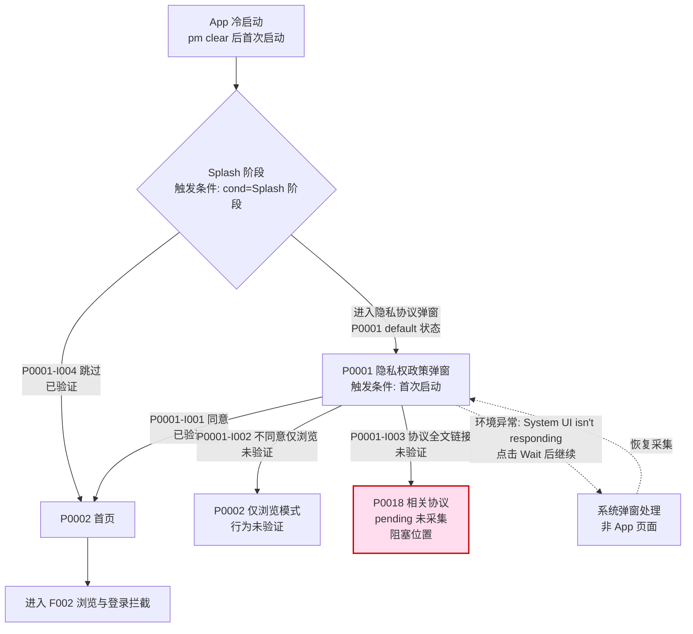

# F001 首次启动与协议同意

> 真实采集流程。实线＝已验证；虚线＝未验证或环境异常。
> 数据：`MASTER_INDEX.json` P0001 / `interactions.json` P0001-I001~I004 / `ENVIRONMENT.md` 第 5 节。

## 流程图

## 步骤说明

| 步骤 | page_id | interaction_id | 触发条件 | 动作 | 结果 | 验证 |
|---|---|---|---|---|---|---|
| 1 | P0001 | P0001-I004 | Splash 阶段 | 点击「跳过」 | 跳过启动页进入 P0002 | 已验证 |
| 2 | P0001 | P0001-I001 | 首次启动 | 协议弹窗点击「同意」 | 进入 P0002 | 已验证 |
| 3 | P0001 | P0001-I002 | 首次启动 | 点击「不同意，仅浏览」 | 以仅浏览模式进入 P0002，行为未验证 | 未验证 |
| 4 | P0001 | P0001-I003 | 首次启动 | 点击协议全文链接 | 目标 P0018（pending 未采集页） | 未验证 |

## 条件分支

- 同意协议 → P0002（已验证，默认主链路）。
- 不同意仅浏览 → P0002（未验证，仅浏览模式行为不得虚构）。
- 协议全文链接 → P0018 pending（未验证，禁止当作真实页面实现）。
- 环境异常：System UI 弹窗遮挡 → 点击 Wait 后继续（模拟器环境异常，非 App 页面）。

## 登录拦截点

无。本流程全程未登录，不触发登录拦截。

## 返回路径

- Splash 跳过 → 直接进入首页。
- 协议弹窗阶段系统返回键行为未验证，不得假定可跳过协议。

## 阻塞位置

- `P0001-I002` / `P0001-I003` 未验证。
- `P0018` 为 `MASTER_INDEX.json` 的 pending 页面，未采集。
- System UI 弹窗为环境异常，不属于 App 页面（见 `ENVIRONMENT.md`）。

## 验证状态

`partial_verified`：P0001-I001 / P0001-I004 已验证，其余未验证。
