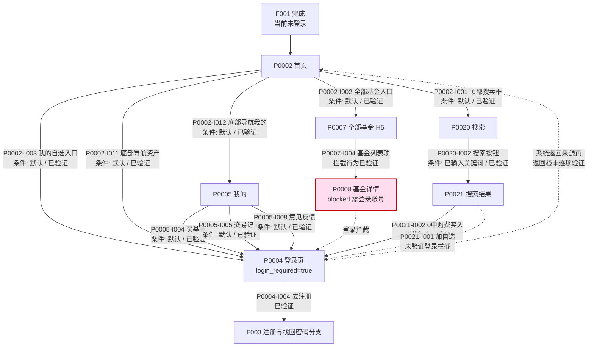

# F002 未登录浏览基金触发登录拦截

> 真实采集流程。实线＝已验证；虚线＝未验证或阻塞。
> 数据：`MASTER_INDEX.json`、`interactions.json`、`01_architecture/PAGE_RELATIONSHIPS.md`。

## 流程图

## 步骤说明

| 步骤 | page_id | interaction_id | 触发条件 | 动作 | 结果 | 验证 |
|---|---|---|---|---|---|---|
| 1 | P0002 | P0002-I003 | 默认 | 点击「我的自选」 | 登录拦截 → P0004 | 已验证 |
| 2 | P0002 | P0002-I011 | 默认 | 点击底部导航「资产」 | 登录拦截 → P0004 | 已验证 |
| 3 | P0005 | P0005-I004 | 默认 | 点击「买基金」 | 登录拦截 → P0004 | 已验证 |
| 4 | P0005 | P0005-I005 | 默认 | 点击「交易记录」 | 登录拦截 → P0004 | 已验证 |
| 5 | P0007 | P0007-I004 | 默认 | 点击基金列表项 | 登录拦截 → P0008（blocked） | 拦截已验证 |
| 6 | P0021 | P0021-I002 | 默认 | 点击「0申购费买入」 | 登录拦截 → P0004，购买流程 blocked | 拦截已验证 |

## 条件分支

- 未登录 → 统一拦截跳转 P0004（已验证）。
- 已登录 → 直达目标页（未验证，无真实账号）。
- 基金详情 / 买入类入口 → 拦截后目标 P0008 / P0036 为 blocked。

## 登录拦截点

P0002-I003、P0002-I011、P0005-I004、P0005-I005、P0007-I004、P0021-I002，全部指向 P0004。

## 返回路径

- P0004 系统返回 → 来源页（具体返回栈未逐项验证）。
- H5 页面返回遵循原生返回栈。

## 阻塞位置

- P0008 基金详情：需登录账号，涉及真实资金展示。
- P0010 我的自选、B0028 交易记录（旧编号已重命名）：触发登录拦截，未验证。
- 已登录态下的目标页面内容全部未验证。

## 验证状态

`partial_verified`：登录拦截行为已验证，登录后目标页 blocked。
