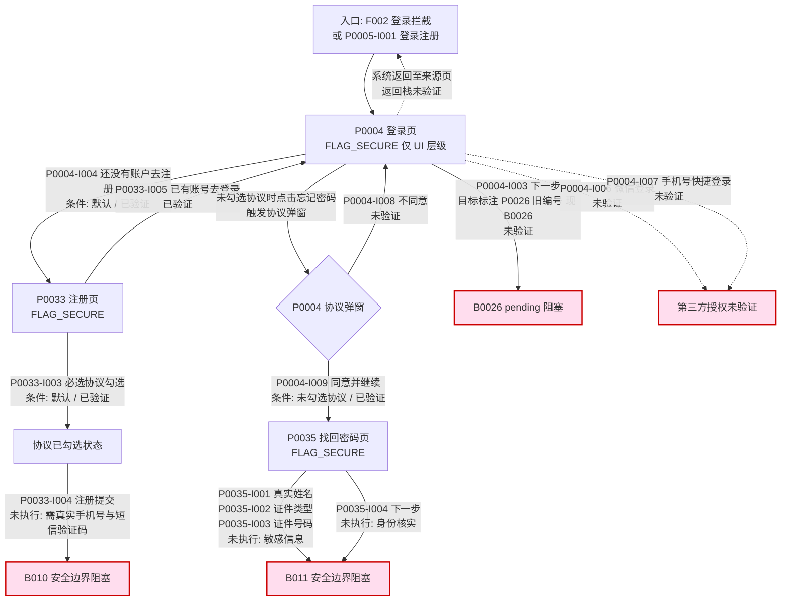

# F003 登录页到注册与找回密码分支

> 真实采集流程。P0004 / P0033 / P0035 均带 FLAG_SECURE，截图为黑屏，仅 UI 层级可读。
> 实线＝已验证；虚线＝未验证或安全边界阻塞。

## 流程图

## 步骤说明

| 步骤 | page_id | interaction_id | 触发条件 | 动作 | 结果 | 验证 |
|---|---|---|---|---|---|---|
| 1 | P0004 | P0004-I004 | 默认 | 点击「还没有账户，去注册」 | 打开 P0033 | 已验证 |
| 2 | P0033 | P0033-I003 | 默认 | 点击必选协议勾选框 | 切换同意状态 | 已验证 |
| 3 | P0033 | P0033-I005 | 默认 | 点击「已有账号，去登录」 | 返回 P0004 | 已验证 |
| 4 | P0004 | P0004-I009 | 未勾选协议时 | 协议弹窗点击「同意并继续」 | 进入 P0035 | 已验证 |
| 5 | P0004 | P0004-I008 | 未勾选协议时 | 协议弹窗点击「不同意」 | 留在 P0004 | 未验证 |
| 6 | P0004 | P0004-I003 | 填写账号后 | 点击「下一步」 | 目标标注 P0026（旧编号，现 B0026），未验证 | 未验证 |

## 条件分支

- 去注册 → P0033（已验证）。
- 忘记密码且未勾选协议 → 协议弹窗 → 同意并继续 → P0035（已验证）。
- 协议弹窗不同意 → 留在 P0004（未验证）。
- 微信登录 / 手机号快捷登录 → 未验证，不得假定登录成功。
- 登录提交「下一步」→ P0026（旧编号，现 B0026）为 duplicate pending 页，未验证。

## 登录拦截点

- P0004 是统一登录拦截目标，来源见 F002。
- P0004-I009 协议弹窗是进入 P0035 的前置拦截点。

## 返回路径

P0033-I005 → P0004；P0035 身份核实未执行；P0004 系统返回 → 来源页（具体栈行为未验证）。

## 阻塞位置

- P0004-I001 / I002 / I005 / I006 / I007 未验证（FLAG_SECURE 仅 UI 层级）。
- P0033-I001 / I002 / I004 未执行：需真实手机号与短信验证码。
- P0035-I001 / I002 / I003 / I004 未执行：需真实姓名与证件号码。
- P0026（旧编号，现 B0026）是 pending duplicate 页，不是真实采集页面。
- 登录成功后的账户页面未验证。

## 验证状态

`partial_verified`：分支跳转已验证，涉及真实账号/身份的提交均 blocked。
