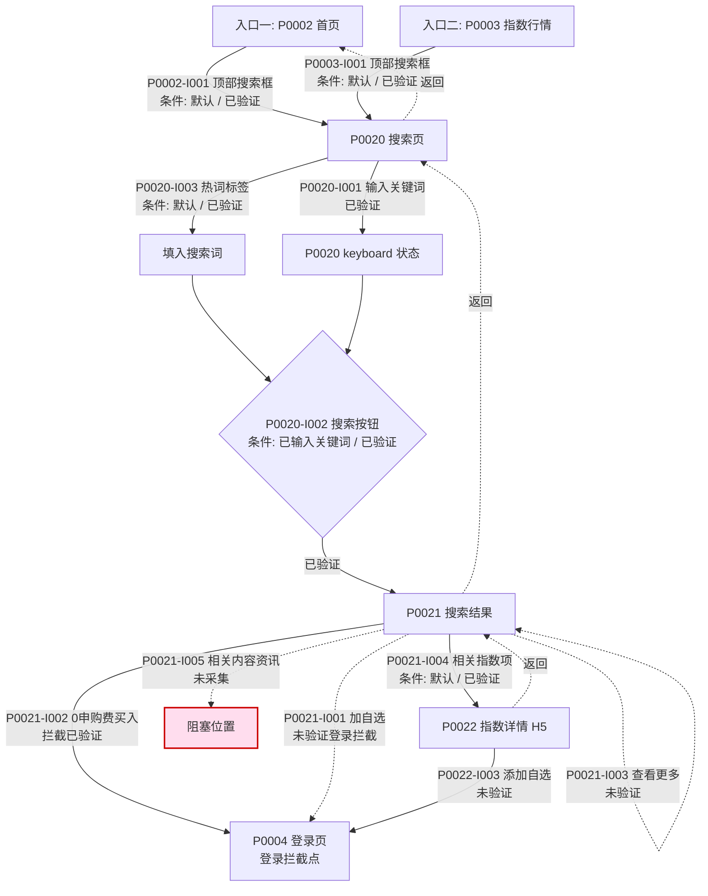

# F004 搜索到搜索结果再到指数详情

> 真实采集流程，主链路全部已验证。实线＝已验证；虚线＝未验证或阻塞。

## 流程图

## 步骤说明

| 步骤 | page_id | interaction_id | 触发条件 | 动作 | 结果 | 验证 |
|---|---|---|---|---|---|---|
| 1 | P0002 | P0002-I001 | 默认 | 点击顶部搜索框 | 打开 P0020 | 已验证 |
| 2 | P0003 | P0003-I001 | 默认 | 点击顶部搜索框 | 打开 P0020 | 已验证 |
| 3 | P0020 | P0020-I001 | 默认 | 输入关键词 | 弹出键盘 | 已验证 |
| 4 | P0020 | P0020-I003 | 默认 | 点击热词标签 | 填入搜索词 | 已验证 |
| 5 | P0020 | P0020-I002 | 输入关键词后 | 点击搜索按钮 | 打开 P0021 | 已验证 |
| 6 | P0021 | P0021-I004 | 默认 | 点击相关指数项 | 打开 P0022 | 已验证 |

## 条件分支

- 首页搜索框 / 指数行情搜索框 → P0020（均已验证）。
- 手动输入关键词 / 点击热词 → 搜索按钮 → P0021（已验证）。
- 相关指数项 → P0022（已验证）。
- 加自选 P0021-I001 / P0022-I003 → 登录拦截（未验证）。
- 0申购费买入 P0021-I002 → 登录拦截 P0004（已验证），后续购买流程 blocked。
- 热门搜索项 P0020-I004 / 查看更多 P0021-I003 / 资讯 P0021-I005 未验证。

## 登录拦截点

P0021-I001（未验证）、P0021-I002（已验证）、P0022-I003（未验证），均指向 P0004。

## 返回路径

P0022 返回 → P0021；P0021 返回 → P0020；P0020 返回 → 来源页（P0002 或 P0003）。

## 阻塞位置

- P0021-I005 资讯详情未采集。
- P0036 基金购买/赎回/转换/定投流程 blocked。
- 登录后的加自选状态未验证。

## 验证状态

`verified_main_path`：主链路全已验证；买入与加自选分支 blocked / 未验证。
