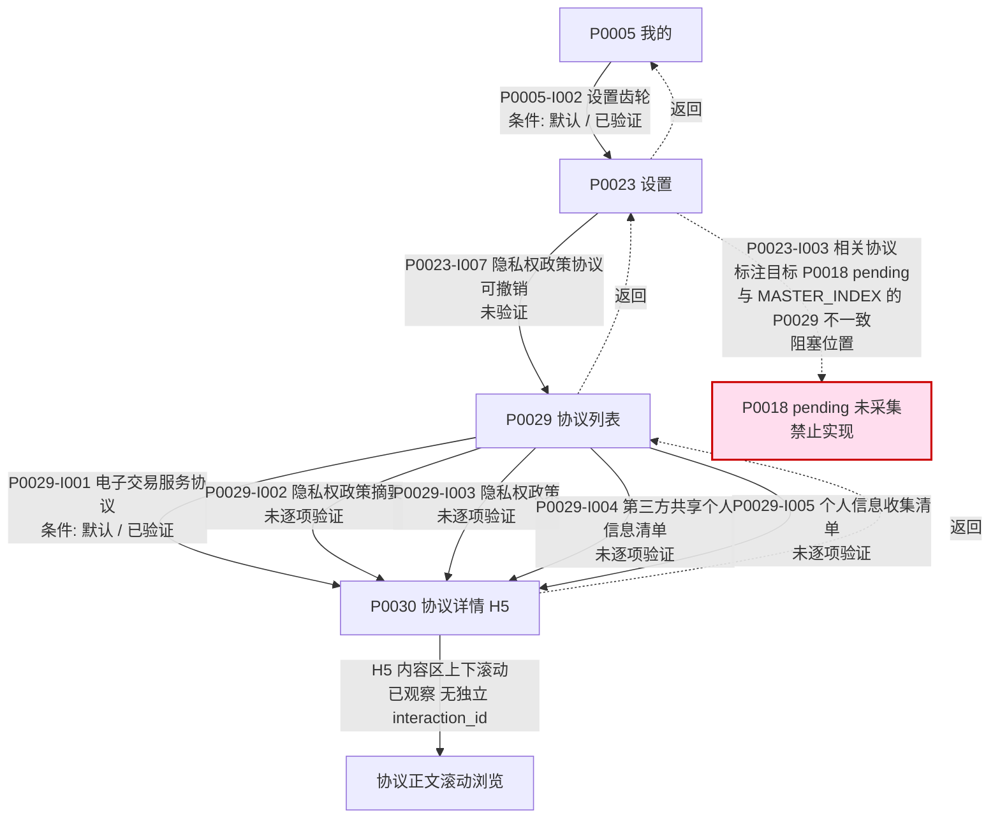

# F005 设置到协议列表再到协议详情 H5

> 真实采集流程。注意：`P0023-I003` 标注目标 `P0018`（pending），`P0023-I007` 标注目标 `P0029`，二者不一致，开发时以 `P0029` 为准并标注未验证。

## 流程图

## 步骤说明

| 步骤 | page_id | interaction_id | 触发条件 | 动作 | 结果 | 验证 |
|---|---|---|---|---|---|---|
| 1 | P0005 | P0005-I002 | 默认 | 点击设置齿轮 | 打开 P0023 | 已验证 |
| 2 | P0023 | P0023-I007 | 默认 | 点击「隐私权政策协议可撤销」 | 目标 P0029 | 未验证 |
| 3 | P0023 | P0023-I003 | 默认 | 点击「相关协议」 | 标注目标 P0018（pending），与 MASTER_INDEX 不一致 | 未验证 |
| 4 | P0029 | P0029-I001 | 默认 | 点击「电子交易服务协议」 | 打开 P0030 | 已验证 |
| 5 | P0029 | P0029-I002 | 默认 | 点击「隐私权政策摘要」 | 打开 P0030 | 未逐项验证 |
| 6 | P0029 | P0029-I003 | 默认 | 点击「隐私权政策」 | 打开 P0030 | 未逐项验证 |
| 7 | P0029 | P0029-I004 | 默认 | 点击「第三方共享个人信息清单」 | 打开 P0030 | 未逐项验证 |
| 8 | P0029 | P0029-I005 | 默认 | 点击「个人信息收集清单」 | 打开 P0030 | 未逐项验证 |

## 条件分支

- 设置齿轮 → P0023（已验证）。
- 设置内协议入口 → P0029（P0023-I007 标注 P0029 但未验证；P0023-I003 标注 P0018 pending）。
- 任一协议项 → P0030 H5（P0029-I001 已验证，其余未逐项验证）。
- P0030 正文上下滚动（已观察，无独立 interaction_id）。

## 登录拦截点

无。

## 返回路径

P0030 返回 → P0029；P0029 返回 → P0023；P0023 返回 → P0005。

## 阻塞位置

- P0018 相关协议为 pending 未采集页。
- P0023-I003 与 P0023-I007 目标 ID 不一致（P0018 vs P0029）。
- P0029-I002 至 I005 未逐项验证。

## 验证状态

`partial_verified`：P0005-I002 / P0029-I001 已验证；协议入口交互未验证。
