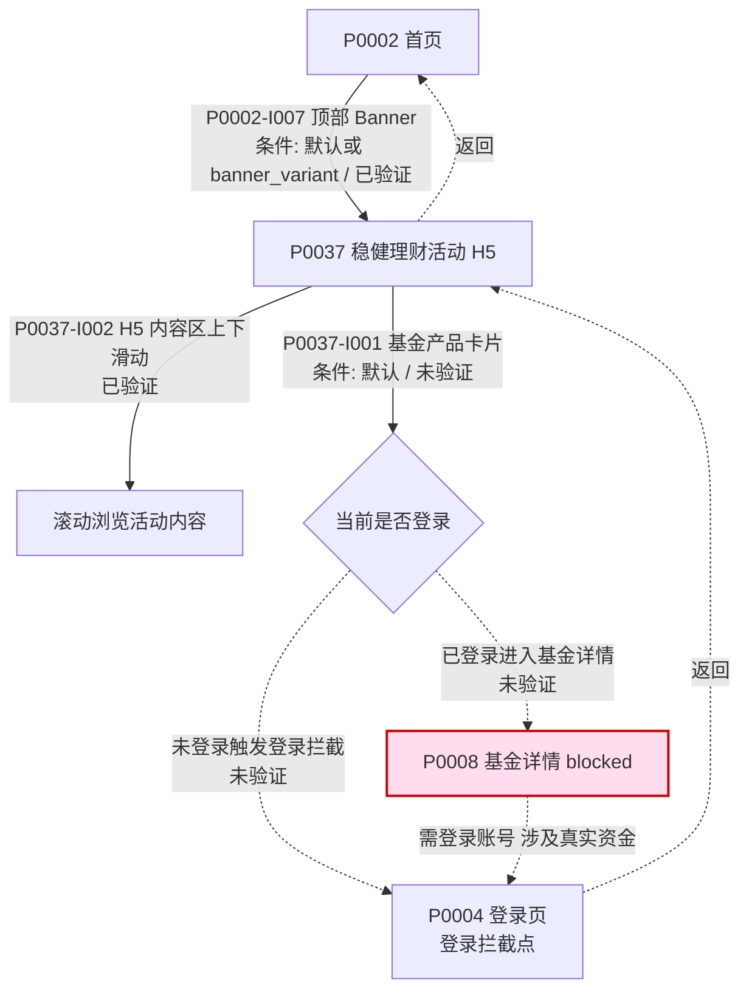

# F006 首页 Banner 到活动 H5

> 真实采集流程。首页顶部 Banner 实际跳转稳健理财活动页 P0037，而非会员中心。

## 流程图

## 步骤说明

| 步骤 | page_id | interaction_id | 触发条件 | 动作 | 结果 | 验证 |
|---|---|---|---|---|---|---|
| 1 | P0002 | P0002-I007 | 默认 / banner_variant | 点击顶部 Banner | 打开 P0037 稳健理财活动 H5 | 已验证 |
| 2 | P0037 | P0037-I002 | 默认 | H5 内容区上下滑动 | 滚动浏览更多活动内容 | 已验证 |
| 3 | P0037 | P0037-I001 | 默认 | 点击基金产品卡片 | 目标 P0008 / 登录拦截 | 未验证 |

## 条件分支

- Banner 默认态 / banner_variant 轮播态 → 同一入口 P0002-I007。
- 点击产品卡片 → 基金详情 P0008 + 登录拦截（未验证）。
- H5 内滚动浏览（已验证）。

## 登录拦截点

P0037-I001 → P0008 → P0004（未验证）。

## 返回路径

P0037 返回 → P0002（WebView 内页返回遵循原生返回栈）。

## 阻塞位置

- P0008 基金详情 blocked：需登录账号、涉及真实资金展示。
- Banner 其他轮播项内容未采集。

## 验证状态

`partial_verified`：Banner 跳转与滚动已验证；产品卡片后续 blocked。
