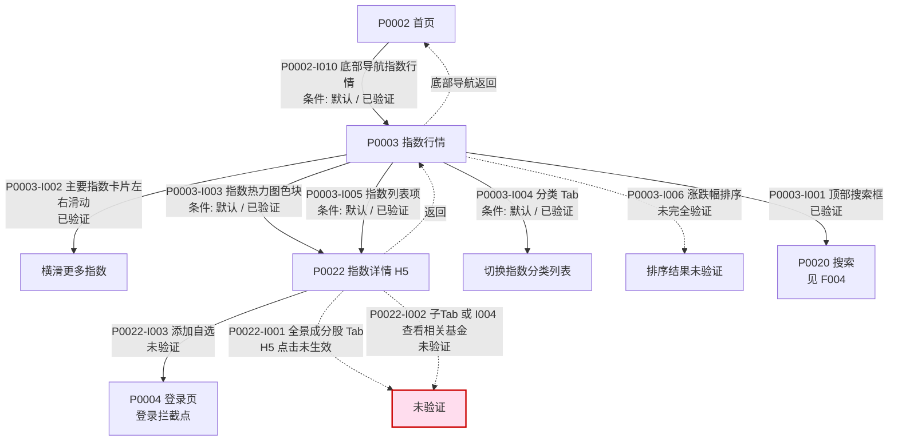

# F007 指数行情到指数详情

> 真实采集流程。指数详情页为 WebView (H5)，部分 H5 内 Tab 点击实测未生效。

## 流程图

## 步骤说明

| 步骤 | page_id | interaction_id | 触发条件 | 动作 | 结果 | 验证 |
|---|---|---|---|---|---|---|
| 1 | P0002 | P0002-I010 | 默认 | 点击底部导航「指数行情」 | 切换至 P0003 | 已验证 |
| 2 | P0003 | P0003-I002 | 默认 | 主要指数卡片左右滑动 | 横滑查看更多指数 | 已验证 |
| 3 | P0003 | P0003-I003 | 默认 | 点击指数热力图色块 | 打开 P0022 | 已验证 |
| 4 | P0003 | P0003-I005 | 默认 | 点击指数列表项 | 打开 P0022 | 已验证 |
| 5 | P0003 | P0003-I004 | 默认 | 点击分类 Tab | 切换指数分类列表 | 已验证 |
| 6 | P0022 | P0022-I003 | 默认 | 点击「添加自选」 | 目标 P0004 登录拦截 | 未验证 |

## 条件分支

- 热力图色块 P0003-I003 / 列表项 P0003-I005 → P0022（均已验证）。
- 分类 Tab 切换（已验证）；涨跌幅排序 P0003-I006 未完全验证。
- P0022 全景/成分股 Tab P0022-I001 实测 H5 点击未生效（未验证）。
- P0022 子 Tab P0022-I002 / 查看相关基金 P0022-I004 未验证。
- 添加自选 P0022-I003 → 登录拦截 P0004（未验证）。

## 登录拦截点

P0022-I003 → P0004（未验证）。

## 返回路径

P0022 返回 → P0003；P0003 底部导航返回首页 → P0002。

## 阻塞位置

- P0022-I001 H5 Tab 点击实测未生效，结果未验证。
- P0022-I002 / I004 未验证。
- 登录后的自选状态未验证。

## 验证状态

`partial_verified`：行情 → 详情主链路已验证；详情页内交互未验证。
