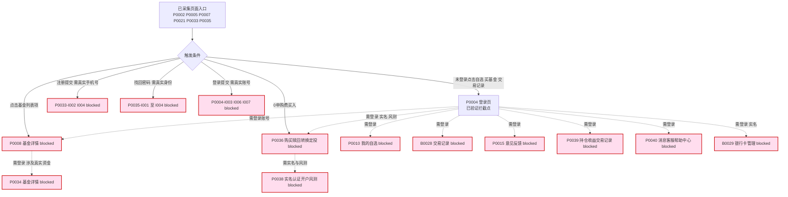

# blocked_flows.md — 未验证 / 阻塞流程汇总

> 本文件汇总所有因登录、FLAG_SECURE、真实身份或真实资金安全边界而**未采集 / 未验证**的业务流程。
> 页面 ID 均来自 `MASTER_INDEX.json` 的 `pages` 或 `pending_pages`；交互 ID 均来自 `interactions.json`。
> **禁止虚构步骤、禁止实现真实资金或身份提交。金融业务仅可实现模拟交互与登录拦截提示。**

## 1. 阻塞分布图

## 2. 阻塞清单

| 阻塞 ID | 名称 | 关联页面 | 关联交互 | 阻塞原因 | 允许实现范围 |
|---|---|---|---|---|---|
| B001 | 基金详情查看 | P0008 / P0034 | P0002-I008、P0007-I004、P0037-I001 | 触发登录拦截，需登录账号，涉及真实资金展示 | 静态模拟页 + 登录拦截提示 |
| B002 | 我的自选 | P0010 | P0002-I003、P0022-I003、P0021-I001 | 触发登录拦截，未验证 | 仅登录拦截跳转 P0004 |
| B003 | 意见反馈 | P0015 | P0005-I008 | 触发登录拦截，未验证 | 仅登录拦截跳转 P0004 |
| B004 | 交易记录 | B0028（旧编号已重命名） | P0005-I005 | 需登录，未验证 | 仅登录拦截跳转 P0004 |
| B005 | 银行卡管理 | B0029（原 pending 同名 P0029，与已采集协议列表 P0029 ID 冲突，现已重命名） | 无 | 需登录 + 实名，未验证 | 禁止实现，仅登记阻塞 |
| B006 | 基金购买/赎回/转换/定投流程 | P0036 | P0021-I002 | 需登录 + 实名 + 风测，涉及真实资金 | 仅模拟按钮与拦截提示，禁止虚构下单/金额/份额/确认步骤 |
| B007 | 实名认证/开户/风险测评 | P0038 | P0035-I001~I004 | 需真实身份信息，按安全边界停止 | 仅展示 UI 层级结构，禁止信息提交 |
| B008 | 持仓/收益/交易记录（登录后） | P0039 | 无 | 需登录，未验证 | 禁止虚构资产数值；如展示须标注 mock 脱敏值 |
| B009 | 消息通知/客服中心/帮助中心 | P0040 | P0005-I003 | 多入口需登录，未验证 | 仅入口占位与登录拦截提示 |
| B010 | 注册提交与短信验证码 | P0033 | P0033-I001、P0033-I002、P0033-I004 | 需真实手机号与短信验证码 | 仅输入态与协议勾选，禁止伪造验证码成功态 |
| B011 | 找回密码身份核实 | P0035 | P0035-I001~I004 | 需真实姓名与证件号码 | 仅展示 UI 层级结构，禁止身份核实提交 |
| B012 | 登录提交 | P0004 | P0004-I001、I002、I003、I005、I006、I007 | 需真实账号/第三方授权；FLAG_SECURE 仅 UI 层级可读 | 仅 UI 与协议弹窗分支，禁止假定登录成功 |

## 3. 其他未验证但非阻塞的交互

以下交互属于已采集页面，但采集时未确认结果，开发时按合理默认实现并**显式标注未验证**：

- `P0001-I002` / `P0001-I003`：仅浏览模式、协议全文链接目标 P0018。
- `P0004-I001` / `I002` / `I005` / `I006` / `I007`：登录页账户类型、输入、协议勾选、微信登录、快捷登录。
- `P0005-I003`：客服/消息图标。
- `P0007-I002` / `I003` / `I005`：筛选、排序表头、时间区间切换。
- `P0011-I002`：权益详情。
- `P0012-I001`：开启目标投。
- `P0013-I001` / `I002` / `I003`：年收入输入、详细测算、开启计划。
- `P0020-I004`：热门搜索项。
- `P0021-I001` / `I003` / `I005`：加自选、查看更多、资讯详情。
- `P0022-I001` / `I002` / `I003` / `I004`：详情页内 Tab、子 Tab、加自选、相关基金。
- `P0023-I001` / `I002` / `I003` / `I004` / `I007`：长辈模式、推送设置、相关协议、好评、协议撤销。
- `P0024-I001` / `I002`：版本检测、升级。
- `P0029-I002` ~ `I005`：其余协议项详情。
- `P0031-I001`：开启长辈模式（未执行，避免改变全局字号影响采集）。
- `P0037-I001`：活动页基金产品卡片。

## 4. 安全边界依据

来自 `ENVIRONMENT.md` 第 3、4 节：

- 无真实账号，未登录状态采集；金融业务流程在提交前停止。
- 不使用真实身份、银行卡、资金账户；不触发任何真实交易。
- 涉及登录/实名/风测/绑卡等流程：在产生真实业务影响前停止并记录阻塞点。
- 采集到的人员姓名/头像等如属真实个人信息，交付时脱敏并标注。
